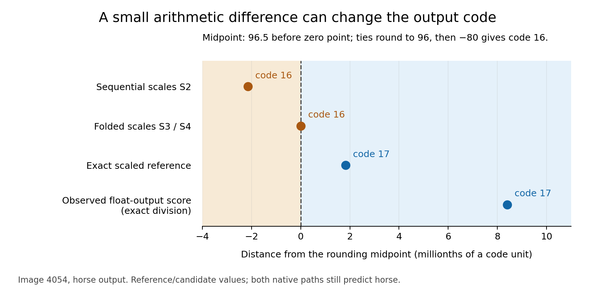

# INT8 exact replay: arithmetic and recorded observations

Companion materials for [**Why I Check Exact Replay When Debugging INT8 Models**](https://debuggerpaco.medium.com/why-i-check-exact-replay-when-debugging-int8-models-67e67cffc0e6), published on Medium on October 22, 2026.
Educational diagnostic; one model conversion and a failure-selected example.

Version 1.0.0: [release and downloadable bundle](https://github.com/gokul-debugger/INT8ExactReplay/releases/tag/v1.0.0).
The current branch includes publication links and the final article wording. The
tagged v1.0.0 bundle remains the original numerical release.


The recorded original classifier gives horse code 16 for test image 4054. Its
float-output replay, followed by output quantization, gives 17. Both predict horse.
The same checked integer sum can reproduce either code through the predefined
scale calculations and rounding. Several candidates match the original codes;
the native fused calculation order remains unresolved.



*Figure 1. Distance from the midpoint for the horse output. The values are exact
references or candidate calculations, not directly observed fused-kernel
intermediates. At 96.5, nearest-even chooses 96; adding zero point −80 gives 16.*

## What you can reproduce

- Exact-reference and binary32 arithmetic for all 33 inputs ×10 classes.
- All 14 code-comparison paths and all 27 boundary probes, including disagreements.
- The target's integer identity, recorded dot+bias=total, and saved bound checks.
- Optionally,126 native standalone QuantizeLinear/DequantizeLinear calls on the
  same recorded scores, scale candidates and boundary probes.

The bundle contains saved numerical observations, not original images, captured
feature arrays, weight matrices or full models. It cannot recompute the integer
dot products from features/weights or rerun the fused classifier/full network.
Those controls are identified as recorded historical evidence. See
[METHODS.md](METHODS.md), [LIMITATIONS.md](LIMITATIONS.md) and
[DATA_DICTIONARY.md](DATA_DICTIONARY.md).

## Run locally

Python 3.12.13 and NumPy 2.5.4 were used for the recorded arithmetic. With NumPy
available, no network access is needed:

```sh
python verify.py
python -m unittest discover -s tests -v
python analyze.py --out generated/analysis
```

`verify.py` checks every manifest-listed file, then regenerates and compares all
seven numerical result files byte for byte. `analyze.py` reports data/reference
agreement; it does not perform inference. Files under `generated/` are local
outputs and are excluded from the reviewed release inventory.

Optional native output-quantizer check, requiring the versions in
`requirements-native.txt`:

```sh
python native_check.py --out generated/native-check.json
```

This reruns only the standalone output quantizer, never QGemm, the original
classifier, training, calibration or a full dataset evaluation. A mismatch fails
the check and records it; there is no relaxed tolerance. Other software/hardware
conditions need a separately labeled check. No script downloads models or data.

To render the figure with the versions in `requirements-figures.txt`:

```sh
python plot.py --out generated/figures
```

See [ARTICLE.md](ARTICLE.md) for the companion article text,
[the numerical table](results/article-table.md),
[all 330 class results](results/all-classes.csv),
[all 4,620 code comparisons](results/code-match-matrix.csv),
[all 594 decisions/ties](results/path-decisions.csv), and
[lossless target arithmetic](results/target.json).

## Reuse

Release terms: MIT for original code; CC BY 4.0 for original writing,
figures and the selection/arrangement of numerical observations. Upstream assets
and dependencies retain their own terms. See [RIGHTS.md](RIGHTS.md) and
[THIRD_PARTY_NOTICES.md](THIRD_PARTY_NOTICES.md). No peer-review status, new
method, kernel bug, universal native instruction order or model accuracy gain
is asserted.
